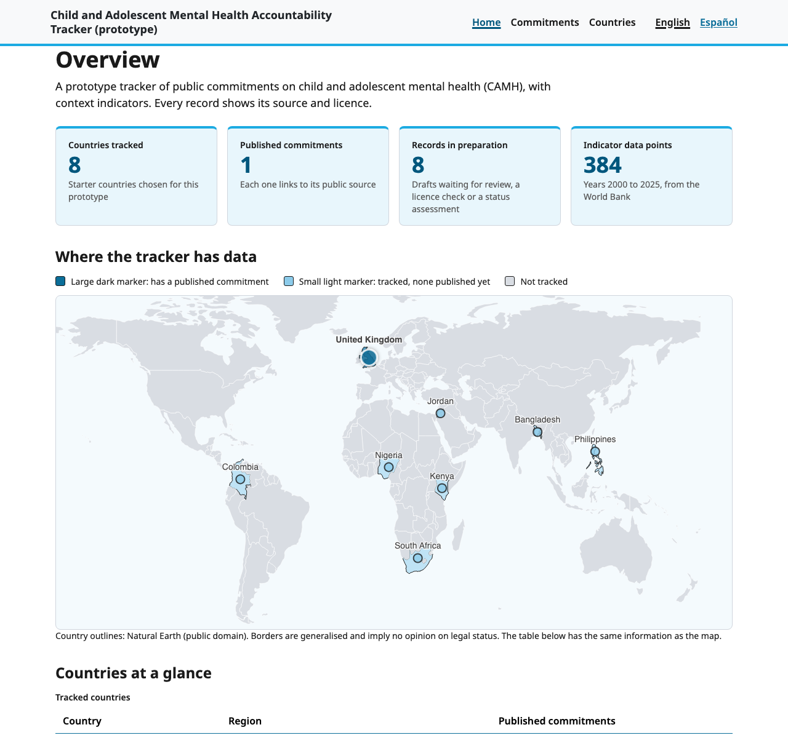
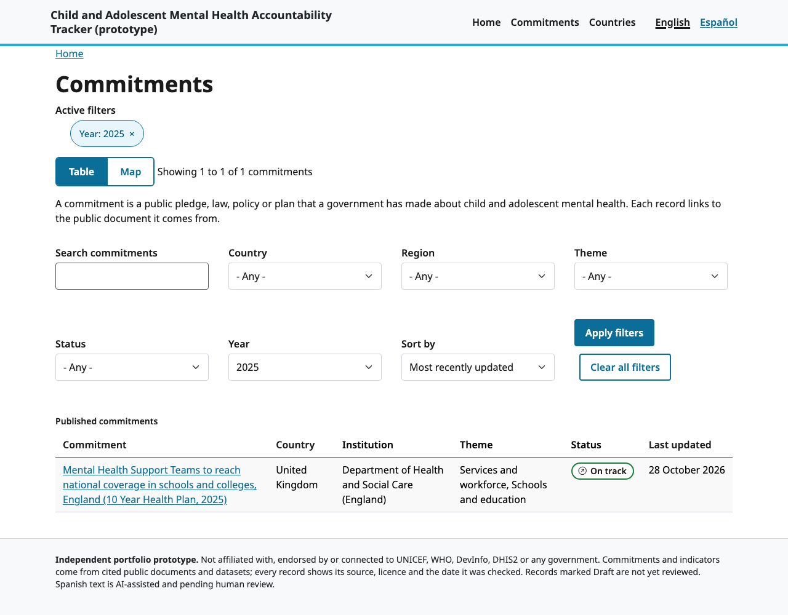
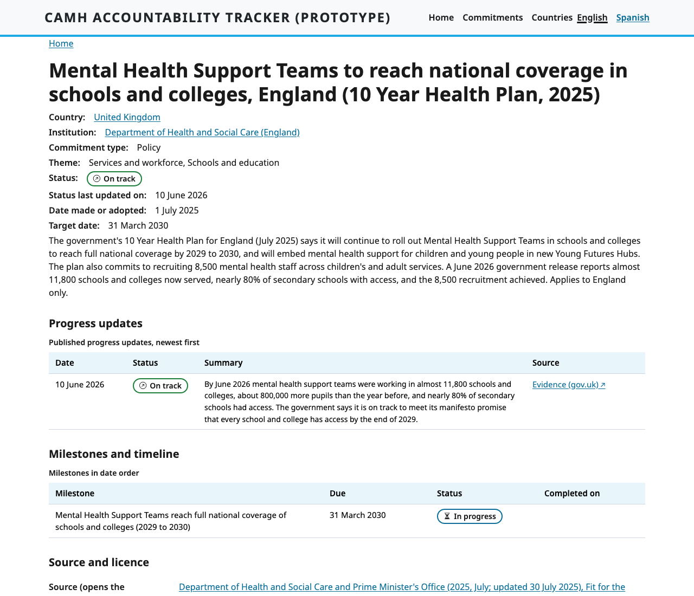
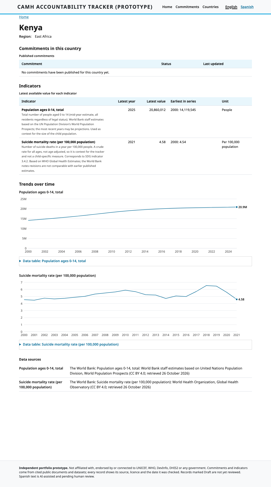

# Case study: a public accountability tracker for child and adolescent mental health

An independent portfolio project, inspired by a public Terms of Reference for an MHPSS design and development role. It is not affiliated with, endorsed by or produced for UNICEF or WHO, and it makes no claim of production readiness. See the [README](../README.md) for the repository map.

## The problem
Governments make public commitments on child and adolescent mental health, and the people who hold them to account (civil society, researchers, journalists, partner agencies) need one place to see what was promised, by whom, with what evidence of progress, alongside comparable indicators. The brief called for a design in Figma, a content-managed website with an admin backend, an interactive dashboard, data import, multilingual support, accessibility and tests.

## What I built
A working Drupal 11 site (run locally with DDEV) with:

- **A content model and review workflow.** Eight content types, eight controlled lists, and a Draft, In review, Published, Rejected workflow. Contributors can save Drafts for their assigned country only; editors approve or reject; only Published records are public.
- **Validation rules from a written data dictionary,** enforced in a custom module: uniqueness, same-country institution, dates, required fields before review, and a provenance rule that blocks publication while a source's licence is "Not yet checked".
- **Public pages:** Overview (KPI tiles, vector map with a table alternative, progress by status), Commitments (search, filters, chips, table or map), commitment detail (history, milestones, source and licence panel), Country profiles with indicator charts, Indicators, and a Data page with CSV and JSON downloads.
- **Admin tools:** CSV import forms for commitments and indicator values that check a file row by row (commitments load as Drafts, values load unpublished), and a read-only JSON:API.
- **Languages:** English, Spanish (AI-assisted, then reviewed by a person; new Spanish text is labelled "pending human review" until checked), and a right-to-left layout test.
- **Quality gates on every push** (GitHub Actions rebuilds the site from exported configuration and CSV on a clean machine): data checks, 11 validation tests, 28 Behat user journeys, and an axe-core accessibility check across 63 page, language and size combinations.

| Overview | Commitments list |
|---|---|
|  |  |
| **Commitment detail** | **Country profile** |
|  |  |

Phone layouts are in `evidence/accessibility`; the right-to-left test is in `evidence/theme`.

## Decisions worth explaining
- **Real, cited data, not invented data.** Eight starter countries (Kenya, Nigeria, South Africa, Bangladesh, Philippines, Colombia, Jordan, the UK). Every commitment links to a public document with a verified-on date and a recorded licence check (`data/licence-check.md`). A commitment is included only where a document supports it; anything added to demonstrate admin workflows is labelled illustrative.
- **Evidence over optimism.** Progress statuses are set only from dated, official sources that relate to the specific action. Where the evidence was partial, the status is "In progress"; where none existed (Colombia), the status is left blank. Sources I set aside, and why, are recorded in each record's verification note. Guidance for repeating the exercise is in `docs/status-evidence-guide.md`.
- **Drafts stay private.** Only the UK record is published. The other eight are held as Drafts until an editor completes review, and a test confirms that Drafts never appear in downloads or in the Spanish version of a page.
- **Accessibility as a build input, not an afterthought.** Status badges carry icons and text, charts have data tables as text alternatives, motion is switched off for visitors who ask for reduced motion, and tables become stacked cards on phones.
- **Vector map instead of a WebGL map.** MapLibre was dropped because WebGL is not available on every device; an ECharts vector map with a table alternative works everywhere.
- **Licences drive what is copied.** Where a publisher's terms do not permit reuse, the tracker links and paraphrases briefly rather than copying text.

## What I found by testing
Twelve defects were found by screenshots, automated checks and CI, and fixed (`evidence/bug-log.md`). The most instructive: the Spanish versions of Draft commitments were publicly visible even though the English originals were hidden (B-001), now prevented by a publication guard and covered by a test; and web addresses generated in the wrong language only surfaced on a clean CI build (B-010), which is why the pipeline rebuilds from scratch.

## Scope and roadmap
| Built and tested | Simulated by design | Roadmap |
|---|---|---|
| Site, workflow, validation, pages, charts, map, downloads, bilingual interface, CSV import for commitments and indicator values, tests, CI | DevInfo and DHIS2 integration are designed and documented (`docs/integrations-and-power-bi.md`), not connected to production systems | High-fidelity Figma screens and clickable prototype; native-speaker review of the Spanish text; evidence-based status for the Colombia record; screen-reader walkthrough in depth; putting the hosting plan (`docs/hosting.md`) into practice |

Design: the Figma file holds the foundations (colour and text styles), three components (button, status badge, text input), a low-fidelity Overview wireframe (desktop and mobile) with reusable header and footer, and a Commitments list wireframe. Remaining wireframes, high-fidelity screens and the prototype are the current design work (`docs/open-items.md`).

## Where to look
| To see | Open |
|---|---|
| Requirement-by-requirement status and limitations | `docs/rtm.md` |
| How the pieces fit | `docs/architecture.md` |
| How an editor works | `docs/admin-guide.md` |
| How the checks run | `docs/ci.md` |
| Integrations and the Power BI comparison | `docs/integrations-and-power-bi.md` |
| Hosting and operations plan | `docs/hosting.md` |
| Editor training | `docs/editor-training-guide.md` |
| Roadmap and open items | `docs/open-items.md` |
| Source and licence for each commitment | `data/licence-check.md`, `data/commitments.csv` |
